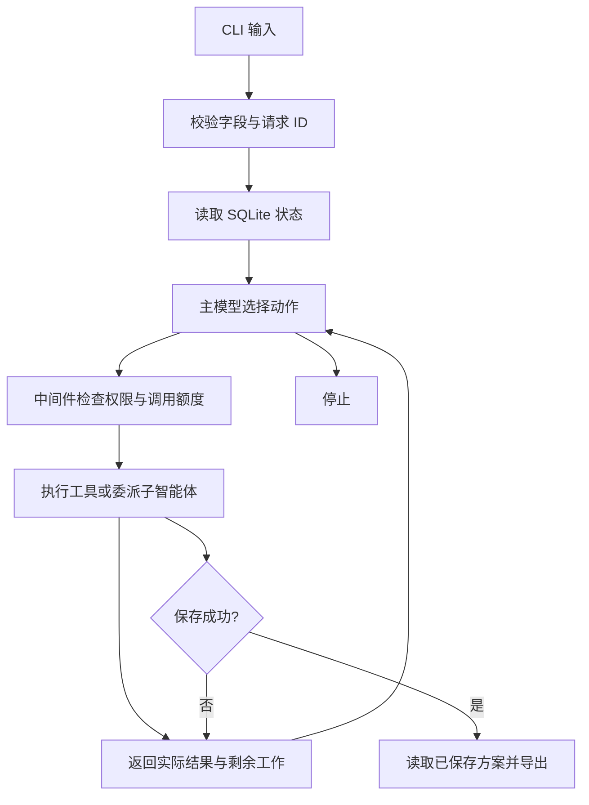

# 实现与技术取舍

项目采用 Python CLI、Deep Agents 和 SQLite。CLI 足以演示完整链路，SQLite 便于核对产物、费用与保存状态。Deep Agents 负责模型与工具之间的消息循环、子智能体调用，以及虚拟文件中的规则读取；业务规则由本项目实现。参考来源见[upstream.md](upstream.md)。

## 调用过程

主 Agent 可以检索、估算、委派创作和审查、保存，也可以在没有可行方案时停止。模型根据观察选择下一步，例如超预算后精简范围、部分成功后只补缺失项、持续失败后改用备用后端。工具负责返回约束和候选方案，不会自动替模型执行降级或重试。

内容包有固定依赖：视频和图文依赖素材与可行报价，渠道改写依赖基础内容，保存依赖当前方案的全部交付物。模型可选择内容包、渠道和后端，并重新估算形成新计划版本；本项目没有实现任意 DAG 编辑。

## 模块与职责

| 模块 | 职责 |
| --- | --- |
| `agent.py` | 建立 Deep Agents 图，限制工具权限，记录模型动作与委派 |
| `planning.py` | 判断结果能否复用，计算剩余工作、费用和时间，提供候选范围 |
| `tools.py` | 检索、估算、生成、保存四个业务工具，检查约束并提交结果 |
| `runner.py` | 输入处理、幂等和续跑、运行上限、最终状态与文件导出 |
| `storage.py` | SQLite 事务和请求锁，保存业务状态与正式方案 |
| `models.py` | OpenAI 兼容模型接入、内容生成，以及离线测试策略 |

Deep Agents 0.7.32、LangChain 1.4.7、LangGraph 1.2.18 和 langchain-openai 1.7.3 的版本由 `uv.lock` 固定。框架承担图执行和消息传递，本项目没有重新实现这些功能。

## 子智能体与执行限制

`config/subagents.yaml` 配置名称、角色、提示和权限，详见[配置说明](07-subagents.md)。默认 `content-writer` 只能调用生成工具，`plan-reviewer` 只能返回审查建议。主 Agent 收到实际工具结果后决定是否重估或再次委派；创作子图通过框架 `return_direct=True` 在一次生成调用后交回控制权。

启用审查者时，保存前必须有当前计划和内容对应的审查记录。这个检查确认审查已执行，内容质量仍需另外评估。创作与审查使用同一份业务状态、账目和调用额度。

虚拟文件系统只提供规则与 Skill，不暴露宿主 `.env` 和数据库。中间件使用工具白名单，拒绝未启用的委派、递归委派、命令执行和文件写入。每次运行最多 20 次模型请求、32 次工具调用，主子模型和生成请求一起计数，客户端不自动重试。

## 结果复用、费用与恢复

成功结果记录渠道、引用素材的版本和依赖内容 ID。重新规划时，先检查范围和引用是否仍适用，再选择可复用内容。渠道改写与它依赖的视频、图文必须构成一致的组合，不能逐项拿最新结果后拼接。换渠道或素材失效时补生成，被替换的结果进入历史，已经发生的费用继续累计。

视频费用为 4、耗时 35 分钟，图文为 4/25，多渠道改写为 4/60。检索、估算和保存各耗时 1 分钟，不计业务费用；失败项不收费，消耗 1 分钟。模型 API 费用另外发生，不计入这套合成报价。

报价绑定计划、规则、素材和适用结果。条件变化后必须重新估算。视频成功而图文失败时保留视频 ID 和费用，模型可只补图文，最终累计费用仍为 8。预算缺口从满足必需渠道等条件的候选计算；步骤状态按实际失败和依赖判断，未尝试项标记为 pending 或 blocked。

SQLite 中，每个成功交付物与其费用同时提交；正式方案与 completed 状态也在同一事务保存。保存成功后停止继续请求模型，最终输出读取已保存的版本。Markdown 导出失败单独记录为 `export_status=failed`，不回滚已经完成的业务提交。

请求锁防止多个进程同时执行同一请求；工具锁保护线程池中的共享状态。委派时释放业务工具锁，使子图能正常调用工具。续跑加载已提交的成功结果和时钟，由模型重新决定剩余动作。

## 模型、时钟与记录

真实模式使用 OpenAI 兼容 Chat Completions。主后端调用模型生成内容，备用后端使用有明确标记的本地模板。离线模式运行相同的图和工具，但模型选择由确定性 Python 策略替代，只用于工程验证。

固定评估时钟按起点加工具耗时计算；真实时钟还包含墙钟流逝。生成和保存前重新检查截止时间。Trace 记录模型公开动作、工具参数、结果、费用与后续调用，不记录隐藏推理。具体测试、实际运行和限制见[评估报告](03-evaluation.md)。
